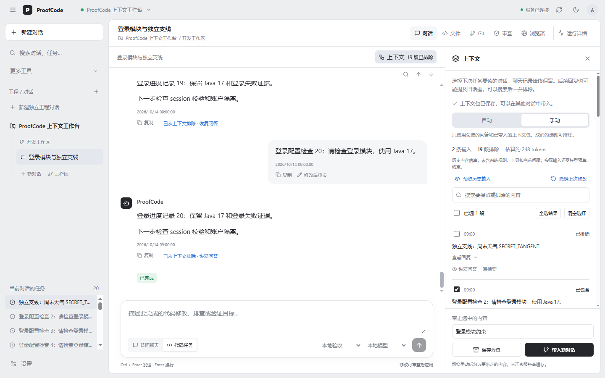
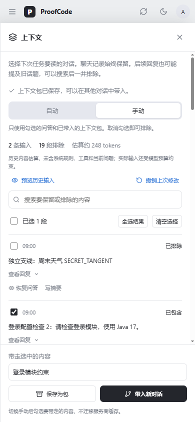

# 2026-10-14：可编辑的对话上下文

同一对话夹杂独立话题后，用户现在可以把那轮问答从后续模型输入中排除，原始聊天仍保留。无需反复发送“忽略某消息”，也无需删掉聊天记录。这是已接入 Java 控制面、Go Runner 和共享 React 工作台的实现，区别于 10 月 13 日仅提出方案的状态。

## 使用方式

1. 在聊天顶部打开“上下文”，或在助手回复下点击“从上下文排除这一轮”。
2. 自动模式和原来一样使用历史，暂不应用手动选择；手动模式可勾选问答、批量包含/排除、恢复，或用手写短摘要替换问答。界面不显示轮次编号。
3. 切到“手动”后，只读取明确包含的问答和已挂载的上下文包。当前问题仍正常发送。
4. “预览历史输入”显示投影内容、来源会话、内容哈希和视图版本。它不调用模型。
5. 在手动模式勾选要带走的问答，命名后“保存为包”或“带入新对话”。同一工作区的其他对话可以带入及卸载包。
6. “撤销上次修改”恢复上一个本地视图。修改立即保存，运行中的任务保持启动时快照，后续新任务采用新视图。

界面沿用工作台灰白与深色主题，桌面右侧面板与聊天各自滚动；手机使用独立抽屉，可按 Escape 关闭并恢复键盘焦点。以下截图来自本地模拟会话，展示交互，不代表真实模型运行结果。

自动与手动切换会保留手动选择；在聊天内直接排除问答会切到手动，并保留其他历史的勾选。

## 实际请求如何改变

- 原始 `conversation_messages` 保留；每个 conversation 保存版本化的当前投影，支持 AUTO/FOCUS 和 INCLUDE/EXCLUDE/REPLACE。
- 以 task + attempt 问答轮为选择单位，最终用户消息与助手回复成组处理。当前归档历史只含 user/assistant 文本，不把半组工具协议迁入新任务。
- 新任务在同一事务内捕获不可变 `context_snapshot`。CHAT 与 CODE 读取同一个历史接口，历史上限在投影过滤后检查；最多 1000 条、2 MiB，超限提示排除或摘要。
- 重试沿用已有快照。旧任务迁移使用第一轮 attempt 的用户消息边界，避免把任务自己的旧失败请求再加入历史。
- Outbox、内部历史响应头和 Runner 检查点绑定快照哈希；恢复时哈希不同或缺失就拒绝复用，避免 `saved.Messages` 绕过选择。
- Durable Compression 接收的历史已过滤，因此本任务保存的 transcript/constraint references 只源于过滤后的材料。跨对话包携带获准文本和来源，不复制旧工具 referenceId，也不放宽 `context_read` 的 scope。
- 上下文包是命名、不可变的选中文本快照，记录来源哈希和各来源的本地投影指纹。来源排除/替换/模式变更会使旧包过期：预览省略过期包，新任务拒绝启动并提示卸载或重建；单纯挂载/卸载包不会让自己的包误判过期。
- 源会话改变不改写正在运行的任务快照。需要立即采用新选择时，停止任务并发送新任务；点击“重试”仍使用原选择。
- 所有公共接口位于项目/工作区路径下，校验账户所有权、消息来源与包作用域，并通过 expected version 拒绝并发覆盖。

## 接口与升级

迁移：`V18__editable_conversation_context.sql`，新增会话投影、任务快照字段及 `context_packs` 表。部署时控制面、Runner 和 Web/桌面共享前端应一起升级；只更新前端不会启用功能。

工作区根路径：`/api/projects/{projectId}/workspaces/{workspaceId}`。

| 方法 | 相对路径 | 用途 |
| --- | --- | --- |
| GET | `/conversations/{conversationId}/context` | 历史投影预览 |
| PATCH | `/conversations/{conversationId}/context` | 带版本更新视图 |
| POST | `/conversations/{conversationId}/context/packs` | 保存选中整轮内容 |
| POST | `/conversations/{conversationId}/context/fork` | 创建并带入新对话 |
| GET | `/context-packs` | 同工作区包列表及过期状态 |

上下文操作不请求外部模型，手写摘要不产生模型费用。可跨对话复用的是文本，服务商 KV/prompt cache 不作为可迁移资产。

## 验证

- 控制面完整 Maven 测试：93 项，84 项通过、9 项外部服务 Live 测试跳过，失败/错误 0。新增覆盖排除、摘要、聚焦、恢复、并发版本、跨作用域拒绝、包来源过期、同源挂载去重、过滤后预算、重试边界，以及 HTTP ownership / Runner header。
- Agent Engine `go test -count=1 ./...` 与 `go vet ./...` 通过；新增 Runner 快照响应头及恢复哈希测试，随后 Runner 套件再次通过。
- 前端单元测试 22 项通过；新增上下文浏览器验证 15 场景，原工作台回归 14 场景通过。覆盖独立滚动、排除、恢复、摘要、撤销、搜索批量操作、聚焦、包保存/挂载/卸载、跨对话带入、手机抽屉与焦点。
- Web 与 Wails 共享前端生产构建通过，保留现有 bundle size 警告；不据此宣称原生桌面全量测试通过。
- 在单个 `--rm` 临时 `pgvector/pgvector:pg16` 容器完整顺序执行 V1–V18，迁移通过；验证后容器移除，未新增常驻部署。
- 桌面、深色及手机界面已截图检查；新功能未请求实际模型网关，没有访问 Codex 官方文档。

复现：在 `control-plane` 执行 `mvn test`；在 `agent-engine` 执行 `go test -count=1 ./...`、`go vet ./...`；在 `frontend` 执行 `npm test`、`npm run build`，在 `desktop/native/frontend` 执行 `npm run build`。启动本地前端 5177 后，从仓库根执行 `node frontend/tests/conversation-context.browser.mjs` 与 `node frontend/tests/chat-workbench.browser.mjs`，需要安装 Playwright 和 Edge；浏览器 API 使用本地 fixture。

## 当前边界

预览是正式历史投影，尚不包含最终 provider 的系统提示、工具 schema、当前问题及预算压缩后的完整 wire request。Token 为 UTF-8 字节保守估算，不是服务商计费值。自动压缩仍采用现有工具协议与预算机制，手写摘要从保留材料人工构建，不生成模型摘要。

排除某轮不能自动抹掉后续回复已复述的相同主题：界面提示搜索后一起排除，或用手动模式只选必要材料。暂不提供主题自动识别、语义依赖推断、完整会话树、固定 PIN、包版本编辑及全部操作审计。原生 DevTools 既有失败仍不属于本次修复范围。
