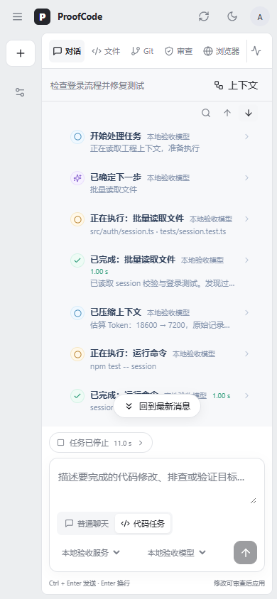
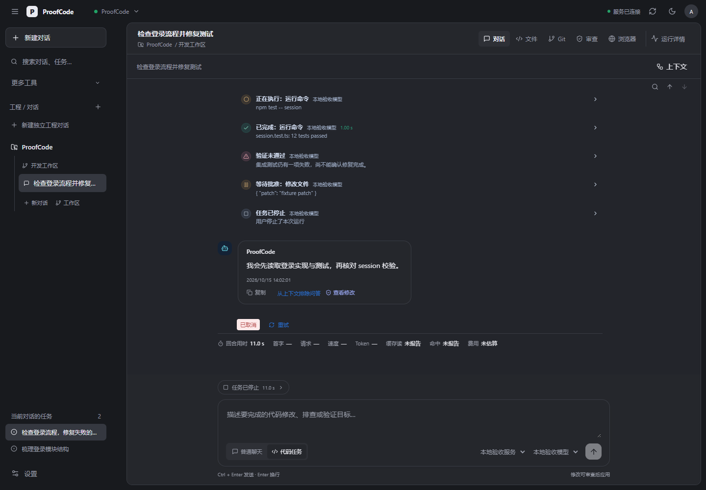

# 2026-10-15：对话中的执行动态与 Windows 桌面包

本次以用户提供的 CineGraph 截图及其 `CineGraph-Web/src/pages/BrainWorkspacePage.tsx` 为布局参考，将 ProofCode 原先藏在“工具执行”折叠框中的过程改成对话内可直接阅读的紧凑动态。只读取参考项目，没有修改 CineGraph，也没有调用模型接口。

## 界面与行为

- 对话背景采用浅灰蓝，助手回复为白色圆角气泡，机器人图标与动态左边距对齐。
- 动态默认显示状态图标、动作标题、模型或协作任务名称、一行摘要。蓝色表示观察，紫色表示选择，琥珀色表示执行或待批准，绿色表示已完成，红色表示失败，灰色表示停止。
- 工具保留开始和结果两个节点；同一调用进入执行或审批后，不再重复显示单独的“已选择”节点。展开后显示输入、输出、时间、原始事件和可计算的执行耗时。
- 工具耗时由同一 attempt、runId、callId 的 started/result 时间差计算；缺少开始记录时不编造耗时。不同重试的调用不互相合并。
- 上下文裁剪、压缩与检索、决策层工具选择、协作任务、验证报告、检查点、恢复补丁、完成、失败、取消均读取已有持久事件。文本 delta 和用量事件不刷成动态条目。
- 只有最新的、仍在运行的工具节点显示旋转动画；待批准及终止任务不旋转，系统减少动态效果设置生效。
- 明确 `passed: false` 的验证显示“验证未通过”；无结构化通过标记的文字报告显示“验证结果已返回”，不会据此标记成功。
- 输入框上方保留当前动作、任务总用时和停止入口；点击动作打开运行详情。停止连接原有取消 API，不新增模拟暂停/恢复功能。
- 历史任务的执行记录接近可视区域才加载，按 500 条分页；失败可重试；任务与重试记录按归属展示。当前任务继续使用 WebSocket / 原生轮询同步。
- 对话保留独立滚动、上下翻页、搜索、复制、草稿、上下文自动/手动选择和运行统计。向上阅读时新增动态不强制跳到底部。

动态在所属任务的助手回复前展示；归档聊天目前每次执行只有一个最终助手消息，因此本次没有虚构逐步思考或重新拆分历史回复。

## 界面验证

截图均为本地接口 fixture 的实际浏览器渲染，不代表真实模型执行结果。

- 前端单元测试：26 项通过，新增调用身份隔离、重复事件、耗时计算、失败验证与协作记录检查。
- 执行动态浏览器测试：7 组通过，覆盖默认显示、键盘展开、输入输出、历史分页/失败重试、阅读位置、审批、真实取消请求、响应布局、深色与减少动态效果。
- 原有聊天工作台浏览器回归：14 组通过。
- 原有上下文管理浏览器回归：15 组通过。
- 浏览器运行时错误：0。所有浏览器请求使用本地 fixture，没有调用模型服务。
- Web 构建与 Windows Wails production 构建通过；仍存在原有大 chunk 提示。
- 原生 exe 已内嵌更新后的共享前端。未在本轮实际启动原生窗口；浏览器截图验证共享 React 界面，不替代 Wails 窗口验证。

## 交付与边界

源码与新编译的 Windows x64 exe 一起打包到 `D:/proofcode`，旧包保留。包内附启动说明、可编辑的后端地址文件、启动脚本、版本信息与文件哈希。

桌面客户端需要 WebView2 和运行中的 ProofCode 后端，尚非只填写 API Key 的独立单文件服务。未复制个人密钥、数据库、聊天历史或依赖目录。
