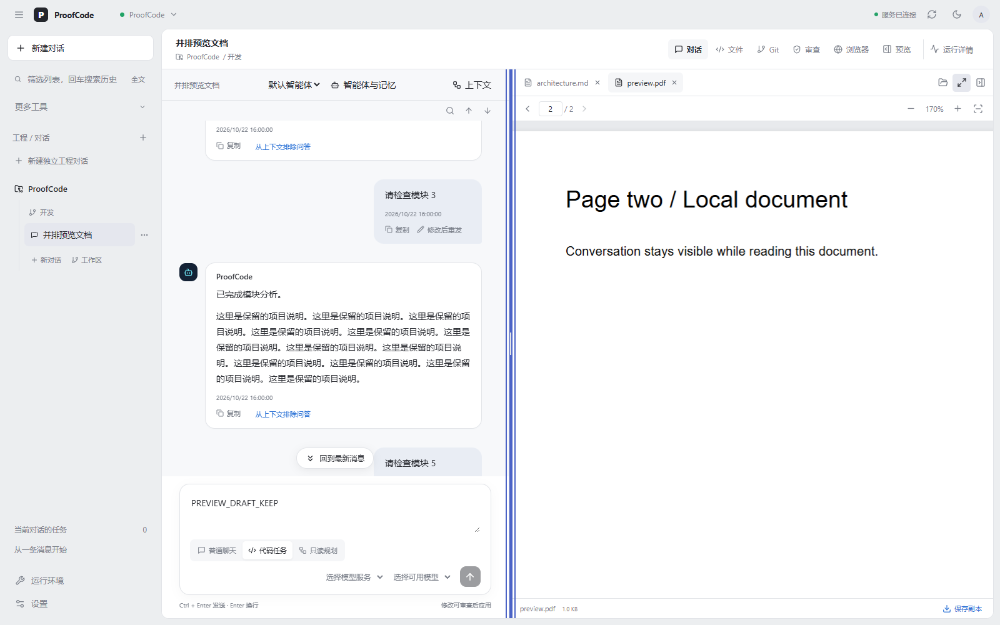

# 2026-10-22 智能体平台与桌面工作区更新

本次将隔离开发区的智能体平台、上下文管理、文档预览及桌面运行管理同步为同一版源码和 Windows x64 客户端。发布从清理后的远端历史继续，不导入旧工作分支历史；论文、个人凭据、会话数据与本地备份均不进入提交或分发包。

## 对话与右侧工作区

- 保留可上下滚动的聊天记录和独立输入区；查看历史时不被新消息强制拉回底部。
- 点击右上角“预览”并排查看 Markdown、TXT、PDF、Word `.docx`，也可将文件拖入右侧。文档只在当前窗口本机预览，不上传、不自动加入模型上下文。
- 多文档标签、单独关闭、收起恢复、鼠标或键盘调宽、全屏与退出；窄屏使用上下分区。
- PDF 支持页码、文字选择、缩放和适合宽度，调宽或切换全屏后保留页内阅读位置。Word 使用隔离沙箱排版，不运行脚本或加载外部资源；旧版 `.doc` 需转为 `.docx`。
- 项目浏览器移至右侧，可与聊天同时查看并全屏；真实网页操作需要桌面端和本地工程。Web 页面不能直接控制客户端浏览器。

图片使用合成文档与本地接口夹具，不包含个人文件，也不代表实际模型输出或真实网页兼容性评测。

## 智能体、工具、Skills 与记忆

- 创建自定义智能体，绑定角色要求、模型、工具白名单、只读限制、Skills 和项目 MCP 服务；任务固定配置快照，后续编辑不会悄悄改变进行中的任务。
- CHAT、只读 PLAN 与 CODE；持久计划、方案转代码、运行中补充指令，以及带审批、取消和检查点恢复的工具执行。
- 运行工具目录支持分类、搜索、调用记录与参数查看，显示实际注册和实际执行的工具。
- MCP 支持管理员 stdio 和用户远程 Streamable HTTP；连接诊断、工具目录、Bearer／认证头和 OAuth PKCE。OAuth 使用预先注册的客户端 ID，尚无动态注册。
- 桌面可生成独立自定义工具服务模板，带 HTTP／stdio 示例、本机知识目录及独立凭据。创建不自动安装依赖、不启动进程；需要 Node.js 22+，按向导手动安装和运行。
- `SKILL.md` 创建、编辑、导入导出、启停和按需读取；账户个人偏好、项目记忆及作用域内的可解释词项检索。
- 自动历史与手动问答选择、排除、摘要替换、上下文包跨对话交接；交接文本，不迁移供应商缓存。

## 修改与运行观测

- 文件和代码选区可加入任务上下文；多文件补丁按文件或代码块选择应用，检查版本冲突，并保护未保存编辑草稿。
- 实时文本增量、检查点级累计 diff、历史任务／补丁和跨对话搜索；检查点预览只读，最终修改仍走审查与应用。
- 支持 Responses、Chat Completions、Anthropic Messages；可选上下文／输入／输出上限、压缩强度和自定义区间计价。
- 展示首字、总请求时间、估算速度、Token、已报告缓存和估算费用；缺失数据保持未知，费用不替代供应商账单。

## 桌面运行与分发

Windows EXE 内嵌最新共享前端、经过文件白名单和哈希校验的源码运行包，以及 MCP 工具模板。登录前可检查运行环境、设置后端地址、准备独立部署目录，并显式启动／停止／检查本项目 Compose 服务。停止保留数据卷。

这仍是需要后端的桌面客户端：Windows 10/11 x64 需要 WebView2；使用本机后端需要 Docker Desktop，工程 Git 操作需要 Git，首次服务构建需网络。已有后端时可设置其地址。分发包不包含 API Key、预览测试账户、用户数据库或离线 Docker 镜像；不是只填 Key 即可独立运行的单文件安装器。

源码包从当前干净代码提交生成，不包含 Git 历史；合并包另带 Windows 客户端、启动说明和 SHA-256 校验信息。

## 验证口径

- 前端 56 项单测，Web 与桌面共享前端生产构建。
- 右侧预览 11 组浏览器检查：真实合成 PDF／Word 渲染、独立滚动、调宽／全屏、阅读位置、文件拖入、错误恢复、窄屏和草稿保留；网页交互使用本地桌面桥夹具。
- Windows Agent Engine 与桌面 Go 全量测试及 `go vet`，自定义工具 Node 8 项测试与依赖审计。
- 控制面全量 Maven 测试，并额外启用实际 Go helper 验证 MCP 诊断与 OAuth；需要外部数据库的 live-data 测试另列，不将跳过计为通过。
- 六个手工标注问题的项目记忆检索回归检查 Recall@3 ≥ 0.83、MRR@5 ≥ 0.65；仅为固定小样本门槛，不是独立真实任务评测。

本轮控制面发现 141 项，132 项通过、0 失败／错误、9 项外部 live-data 测试未开启；MCP 诊断／OAuth 的 13 项已用实际 Go helper 启用并通过。Windows x64 Wails 原生构建成功，内嵌运行源码 275 份、MCP 模板 14 份。尚未完成真实供应商任务成功率评测、完整独立安装器、离线镜像、MCP 依赖自动安装／生命周期和 embedding 检索；不能据夹具通过宣称已追平成熟商业 Agent。

进一步说明：[平台运行](agent-platform-runtime.md) · [验收记录](agent-platform-upgrade.md) · [源码检索与上下文](backend-context.md)。
